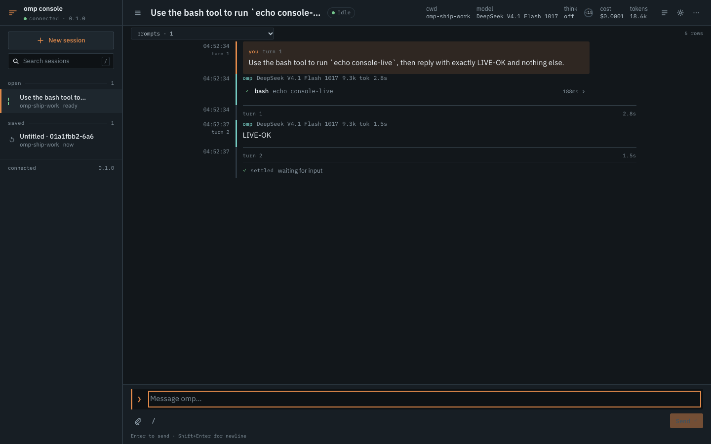
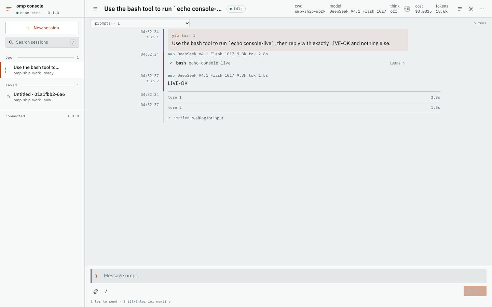
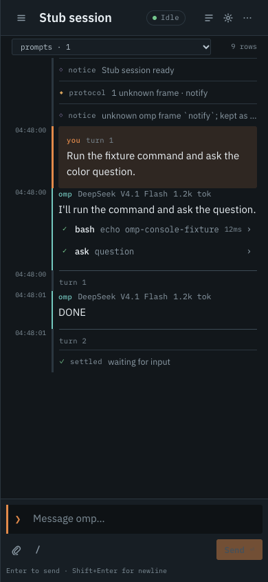
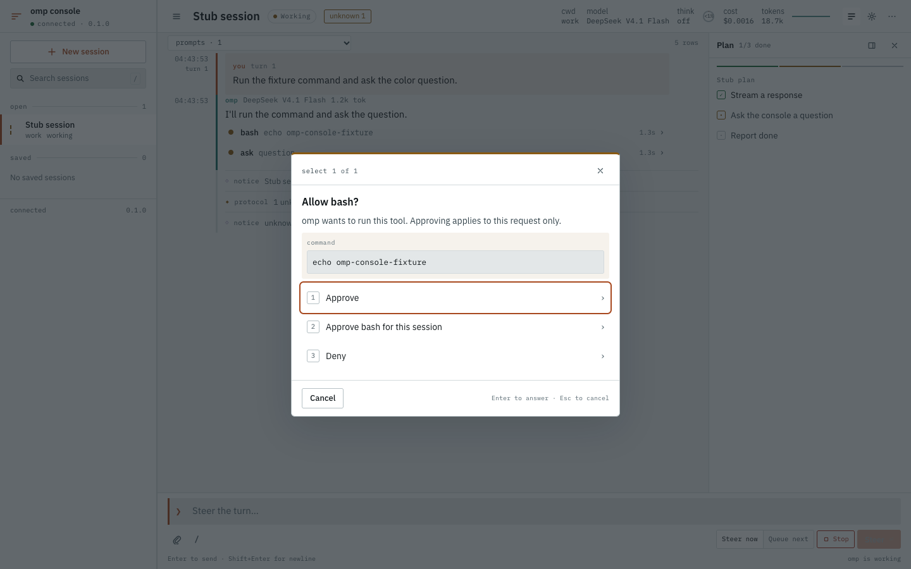
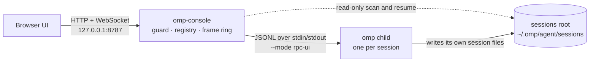

# omp-console

An unofficial local web console for the [`omp`](https://omp.sh) agent harness.

omp-console spawns one real `omp --mode rpc-ui` child per session and streams its
text, thinking, tool calls and dialogs into a browser UI on loopback. You can steer
a running turn, queue follow-ups, answer approvals, change the model or thinking
level, and resume sessions from omp's own session files. It is a console, not a
reimplementation of the agent: it does not call a model itself and never writes
omp's session files.

One Rust binary, one loopback port, embedded web assets, no accounts, no cloud, no
telemetry. MIT.



## Status

**v1.0.0.** Supported `omp`: 18.x, contract recorded and tested against **18.18.8**
(see [supported versions](#supported-omp-versions)). This is an unofficial project;
it is not affiliated with the omp maintainers.

## Install

From a release tarball (darwin-arm64, darwin-x64, linux-x64):

```bash
# download the archive and its .sha256 from the v1.0.0 release, then:
tar -xzf omp-console-<target>-1.0.0.tar.gz
cd omp-console-<target>-1.0.0
./omp-console
```

From source:

```bash
git clone https://github.com/mrsase/omp-console
cd omp-console
make build          # builds web/dist, then the debug workspace
cargo install --path crates/omp-console
```

The release binary already contains the web bundle. A source build must build
`web/dist` first; `make build` and `make verify` do that.

## Quick start

```bash
omp-console
# open http://127.0.0.1:8787
```

`omp` must be on `PATH`, or set `OMP_BIN=/path/to/omp`. The console binds
`127.0.0.1:8787` by default. There is no login: do not expose the port beyond
loopback (see [security](#security-posture)).

## What it does

- **Sessions** — spawn in any folder with an optional model and thinking level;
  concurrent sessions up to `OMP_CONSOLE_MAX_THREADS` (default 8); stop, close,
  fork, new-session-in-place; resume from Saved history; a closed session leaves
  its transcript on disk.
- **Streaming transcript** — assistant markdown, thinking, tool calls with live
  partial output, tool results, terminal runs, system events, compactions and turn
  boundaries. A time gutter, prompt outline, jump-to-latest, and auto-follow that
  pauses when you scroll away. Tool output is collapsed and capped; rows are
  virtualized.
- **Control** — steer mid-turn, queue a follow-up, remove or promote queued input,
  stop a turn, and restore withdrawn queued text and images to the composer.
- **Dialogs** — approvals, `select`, `confirm`, `input`, `editor`, the rich `ask`
  shape and the field-by-field `ask` tool flow; extension notices, statuses,
  widgets and editor text; pending dialogs are replayed to a client that attaches
  late.
- **Session settings** — provider-grouped model picker, thinking level from the
  child's list, auto-compaction, context usage, cost, tokens, and live token rate.
- **Composer** — slash commands with aliases, image attachments (up to 4 JPEGs,
  ~150 KiB each), drag/drop and paste, keyboard shortcuts, IME-safe submission,
  per-session drafts, and a queue strip.
- **Plan and themes** — plan/todo panel grouped by phase, read mode, light and dark
  themes from the design system, reduced motion, visible focus, and 200% zoom.

| Light | Mobile | Approval |
| --- | --- | --- |
|  |  |  |

More: [ask field](docs/screenshots/ask-dark.png), [plan panel](docs/screenshots/desktop-plan.png),
[mobile light](docs/screenshots/mobile-light.png).

## Supported omp versions

| omp version | Status |
| --- | --- |
| **18.x** | Supported. The protocol contract is recorded from 18.18.8 and tested against it. |
| **< 18 or ≥ 19** | Refused before spawning, with a message naming the detected version, the supported range and the override. |

Set `OMP_CONSOLE_SKIP_VERSION_CHECK=1` to run against an unverified `omp`
deliberately. The resolved binary and version are reported by `/api/info` and
shown in the UI, so an override is visible rather than silent.

## Security posture

The console is a local tool with no authentication, by design. It listens on
loopback only; any local process can reach it. It can run `omp` tools with your
privileges, so treat it like a terminal: never expose it directly to a network,
and never bind `0.0.0.0` without an authenticating reverse proxy.

Requests are checked for `Host`, `Origin` and `Sec-Fetch-Site`; the outbound
command set is an explicit allowlist; resume paths are contained to the session
root; payloads and frame rings are capped; children are torn down by process
group. The full threat model, non-goals and reporting process are in
[`SECURITY.md`](SECURITY.md).

## Architecture

Two crates and a web app, embedded into one binary and served on one port:



- `crates/omp-protocol` — frame classification, exact protocol-v2 chunk rules,
  command allowlist, dialogs, version range and fixture loading. No async, no
  process, no filesystem.
- `crates/omp-console` — axum server, process supervision, registry, byte-bounded
  frame ring, HTTP/WS, embedded assets. Integration tests drive a scriptable stub
  `omp`.
- `web/` — React 19 + TypeScript strict + Vite; a normalized store with per-row
  subscriptions and a virtualized transcript; a pure reducer tested against the
  same golden fixtures as the Rust parser.
- Assets are embedded at compile time via `rust-embed`; `make build` builds
  `web/dist` first.
- [`docs/adr/0002-architecture.md`](docs/adr/0002-architecture.md) has the full
  layout, state machine and HTTP/WS surface.

## Measured

From [`docs/evaluation.md`](docs/evaluation.md) on the release build:

| Metric | Value |
| --- | --- |
| Release binary | 3.2 MB |
| JS bundle | 115 KB gzip |
| CSS | 8 KB gzip |
| Idle console RSS | 2.1 MB |
| Console TTFT (stub) | 15 ms median |
| 10k events | 0 long tasks >100 ms, +11 MB heap |

## Development

These are the cycle commands from [`docs/CYCLE.md`](docs/CYCLE.md):

| Command | Purpose |
| --- | --- |
| `make build` | Build the web bundle, then the workspace (debug). |
| `make test` | `cargo test --workspace`. |
| `make web-test` | Vitest: store, protocol reducer, components. |
| `make e2e` | Playwright journeys against the stub `omp`, including axe. |
| `make verify` | The gate CI runs: fmt, clippy `-D warnings`, Rust tests, web install/typecheck/lint/vitest/build, release build, line budget. |
| `make validate` | Stub journey end to end, then the recorded manual live run. |
| `make evaluate-gate` | Check `docs/evaluation.md` for the measured go/no-go. |

`make verify` compiles the Rust workspace three times by design (test, clippy and
release profiles). Use the narrow loops from `docs/CYCLE.md` while working; do not
put `verify` in a loop.

## Documentation

| Document | Contents |
| --- | --- |
| [`docs/v1-design.md`](docs/v1-design.md) | Scope, seven surfaces, A1–A12, milestones, roadmap. |
| [`docs/CYCLE.md`](docs/CYCLE.md) | Phases, artifacts, gate commands, branch and tag rules. |
| [`docs/adr/0001-protocol-contract.md`](docs/adr/0001-protocol-contract.md) | The omp protocol contract. |
| [`docs/adr/0002-architecture.md`](docs/adr/0002-architecture.md) | Workspace split, supervision, HTTP/WS, security module. |
| [`docs/adr/0003-ui-identity.md`](docs/adr/0003-ui-identity.md) | UI identity and interaction rules. |
| [`docs/DESIGN.md`](docs/DESIGN.md) | The design system. |
| [`docs/poc-findings.md`](docs/poc-findings.md) | What the PoC proved, measured, and got wrong. |
| [`docs/fixtures/`](docs/fixtures/) | Golden protocol fixtures and sanitization rules. |
| [`docs/verification.md`](docs/verification.md) | Gate output and versions. |
| [`docs/validation.md`](docs/validation.md) | Stub journey, live run, screenshots, timings. |
| [`docs/evaluation.md`](docs/evaluation.md) | Numbers and the signed go/no-go. |

## Roadmap

| Idea | Why it waits |
| --- | --- |
| Live subagent view | The protocol supports subagent subscriptions and frames, but it multiplies event volume and needs its own lane, filtering and perf budget. |
| Session tree / branch editor | `get_tree`, `branch`, `navigate_tree` and `set_label` exist, but branching needs undo, diff and target-selection UX before it is safe to expose. |

Goal mode, voice, host tools and remote bind/auth are also out of scope; reasons are
in [`docs/v1-design.md` §6](docs/v1-design.md).

## License

MIT. See [`LICENSE`](LICENSE).
