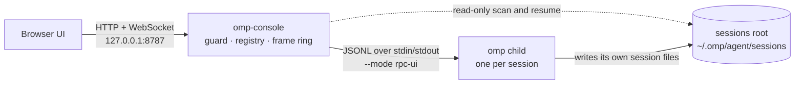

# omp-console

An unofficial local web console for the `omp` agent harness.

omp-console is an unofficial console for the omp harness. v1.0 is designed to run one real
`omp` child process per session, stream text, thinking, tool calls, dialogs and approvals into
a browser UI on a loopback port, let you steer a running turn, and resume sessions from omp's
own session files. It will not reimplement the agent: the console will not call a model
itself, will not write omp's session files, and will not send anything off the machine. v1.0
is planned as one Rust binary, one loopback port, MIT licensed.

**Design phase, not yet released.** There is no installable binary and no product code in the
repository yet. The v1.0 scope, acceptance criteria and proof for each claim are in
[`docs/v1-design.md`](docs/v1-design.md). The earlier proof-of-concept is preserved as
evidence on the `poc` branch at tag `poc-archive`; it is history, not a shipping base.

## Install

Nothing is published today. v1.0.0 will ship a release binary for darwin-arm64, darwin-x64
and linux-x64, plus a source install path. These commands are the planned interface, not
something that works in the design phase:

```bash
# Planned for v1.0.0 — not available yet.
tar -xzf omp-console-v1.0.0-darwin-arm64.tar.gz
./omp-console

# Planned source install, once the workspace exists:
cargo install --path crates/omp-console
```

## Quick start

v1.0.0 will be one binary: it serves the UI from embedded assets and spawns `omp` children
itself, so there is no separate web server to run.

```bash
# Planned for v1.0.0.
omp-console
# open http://127.0.0.1:8787
```

`omp` 18.x must be on `PATH`, or set `OMP_BIN=/path/to/omp`. The console binds
`127.0.0.1:8787` by default. There is no login: do not expose the port beyond loopback (see
[Security](#security-posture)).

## What v1.0 will ship

The seven surfaces from [`docs/v1-design.md` §3](docs/v1-design.md):

- **Sessions** — spawn in any folder with optional model and thinking; concurrent sessions up
  to a configurable cap (default 8); stop, close, fork, new-session-in-place; resume from
  omp's session files; a closed session stays visible under Saved history.
- **Streaming transcript** — assistant markdown, thinking, tool calls with live partial
  output, tool results, terminal runs, system events, compactions and branch summaries;
  collapsed tool rows, prompt outline, and auto-follow that pauses when you scroll away.
- **Control** — steer mid-turn, queue and remove follow-ups, promote a queued item, stop a
  turn, and restore withdrawn queued input to the composer.
- **Dialogs** — the `ask` tool (field by field in RPC mode) and the rich `ask` method,
  approvals, `select`, `confirm`, `input`, `editor`, extension UI requests, and replay for a
  client that attaches late.
- **Session settings** — provider-grouped searchable model picker, thinking level from the
  child's list, auto-compaction, context ring, cost, tokens, live token rate and a 30-second
  sparkline; changes apply to the next turn.
- **Composer** — slash commands with aliases, image attachments (up to 4 JPEGs compressed to
  ≤150 KiB each), drag-and-drop and paste, keyboard shortcuts, IME-safe submission, per-session
  drafts, and a queue strip.
- **Plan and themes** — plan/todo panel grouped by phase, read mode, light and dark themes,
  reduced motion, visible focus, and 200% zoom.

A short list of things v1.0 deliberately does not do is in
[§6 of the design](docs/v1-design.md).

## Supported omp versions

| omp version | Status |
| --- | --- |
| **18.x** | Supported. The protocol contract is recorded from 18.18.8 and tested against that version. |
| **< 18 or ≥ 19** | Refused with an actionable message naming the detected version, the supported range and the override below. |

Set `OMP_CONSOLE_SKIP_VERSION_CHECK=1` to run against an unverified `omp` deliberately. The
resolved binary and version will be reported by `/api/info` and shown in the UI, so an
override is visible rather than silent.

## Security posture

The console is a local tool with no authentication, by design. It will listen on loopback
only, and any local process on the machine can reach it. It can start `omp` sessions, which
run tools with your privileges, so treat it like a terminal: never expose it directly to a
network, and never bind `0.0.0.0` without putting an authenticating reverse proxy in front of
it. The v1.0 design checks `Host`, `Origin` and `Sec-Fetch-Site`, restricts the outbound
command set to an explicit allowlist, contains resume paths to the session root, caps payloads,
and tears children down by process group. The full threat model, non-goals and reporting
process are in
[`SECURITY.md`](SECURITY.md).

## Architecture

v1.0 is designed as two crates and a web app, embedded into one binary and served on one port:



- `crates/omp-protocol` — wire types, chunk reassembly, command allowlist, version range and
  fixtures. No async, no process, no filesystem.
- `crates/omp-console` — axum server, process supervision, registry, frame ring, HTTP/WS,
  embedded assets. Its integration tests drive a scriptable stub `omp`.
- `web/` — React 19 + TypeScript + Vite; a normalized store with per-row subscriptions, and a
  pure reducer tested against the same golden fixtures as the Rust parser.
- Assets are embedded at compile time via `rust-embed`; `make build` builds `web/dist` first.
- `docs/adr/0002-architecture.md` has the full layout, state machine and HTTP/WS surface.

Real screenshots will be added to `docs/screenshots/` during the validation phase; this page
intentionally ships none yet.

## Development

These are the cycle commands defined in the `Makefile`; they operate on code that arrives in
the code phase. [`docs/CYCLE.md`](docs/CYCLE.md) defines the phases and gates.

| Command | Purpose |
| --- | --- |
| `make build` | Build the web bundle, then the workspace (debug). |
| `make test` | `cargo test --workspace`. |
| `make web-test` | Vitest: store, protocol reducer, components. |
| `make e2e` | Playwright journey against the stub `omp`. |
| `make verify` | The gate CI runs: fmt, clippy `-D warnings`, tests, web typecheck/lint/vitest/build, release build, line budget. |
| `make validate` | Stub journey end to end, then the recorded manual live run. |

`make verify` compiles the Rust workspace three times by design (test, clippy and release
profiles). Use the narrow loops from `docs/CYCLE.md` while working; do not put `verify` in a
loop.

## Documentation

| Document | Contents |
| --- | --- |
| [`docs/v1-design.md`](docs/v1-design.md) | Scope, surfaces, acceptance criteria A1–A12, milestones, roadmap. |
| [`docs/CYCLE.md`](docs/CYCLE.md) | Phases, artifacts, gate commands, branch and tag rules. |
| [`docs/adr/0001-protocol-contract.md`](docs/adr/0001-protocol-contract.md) | The omp protocol contract. |
| [`docs/adr/0002-architecture.md`](docs/adr/0002-architecture.md) | Workspace split, supervision, HTTP/WS, security module. |
| [`docs/adr/0003-ui-identity.md`](docs/adr/0003-ui-identity.md) | UI identity and interaction rules. |
| [`docs/DESIGN.md`](docs/DESIGN.md) | The design system. |
| [`docs/poc-findings.md`](docs/poc-findings.md) | What the PoC proved, measured, and got wrong. |
| [`docs/fixtures/`](docs/fixtures/) | Golden protocol fixtures and their sanitization rules. |

## Roadmap

| Idea | Why it waits |
| --- | --- |
| Live subagent view | The protocol supports subagent subscriptions and frames, but it multiplies event volume and needs its own lane, filtering and perf budget. |
| Session tree / branch editor | `get_tree`, `branch`, `navigate_tree` and `set_label` exist, but branching needs undo, diff and target-selection UX before it is safe to expose. |

Goal mode, voice, host tools and remote bind/auth are also out of scope; reasons are in
[§6](docs/v1-design.md).

## License

MIT. See [`LICENSE`](LICENSE).
