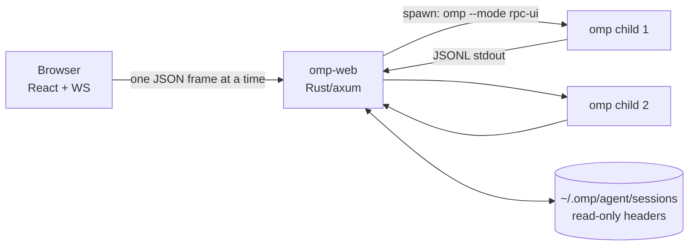

# omp web

A local web console for [omp](https://omp.sh) sessions. It spawns real `omp`
processes over omp's RPC mode and streams them into a fast, minimal React UI.

- Multiple concurrent sessions, each with its own omp process and working folder.
- Live streaming of assistant text, thinking, tool calls, and tool output.
- Model and thinking-level pickers, context usage, cost, token rate.
- Steer a running turn, queue follow-ups, stop and restore queued input.
- The `ask` tool renders as a real dialog; approvals and extension UI requests are surfaced.
- Todos/plan panel, slash-command palette, image attachments (auto-compressed).
- Recent-session list backed by omp's own session files; resume with one click.
- Dark/light themes, responsive layout, no UI framework.
- Compact session settings in a keyboard-accessible dialog on narrow/short windows;
  short windows also use a single-row header and compact composer to preserve
  reading space without requiring a minimum window size.
- Idle phone composers place attachment/send controls beside the input to save
  reading space; Shift+Enter grows a multiline draft without submitting it.
- A prompt outline and “Jump to latest” navigate long histories. Long prompts
  expand from a stable starting point; the navigation row can collapse expanded
  prompts without covering the text. Scrolling away pauses automatic following.
  Extension context also collapses.
- The plan uses a fixed header and independently scrolling body; Escape dismisses
  it and restores keyboard focus. Completed tasks retain readable text and are
  identified by checkmarks rather than strikethrough.
- Read mode gives the transcript the viewport without discarding the composer
  draft; Exit read or Escape restores the normal layout. Plans have Expand/Restore
  controls for reading long task lists in short windows.
- Sidebar titles use two lines; full titles and workspace paths are available
  in row tooltips. Settings also shows the stored title and a distinguishing session ID.

## Requirements

- Rust 1.88+ (edition 2024) — tested with 1.95
- Bun 1.4+ — only to build the frontend
- Node 22+ — only for `scripts/smoke.mjs`
- `omp` 18.x on `PATH`, or set `OMP_BIN` to its path

## Quick start

```bash
make build          # builds web/dist, then the release backend
./server/target/release/omp-web
```

Open <http://127.0.0.1:8787>.

Development loop:

```bash
# terminal 1 — backend on :8787
cargo run --manifest-path server/Cargo.toml

# terminal 2 — Vite on :5173, proxying /api and /ws
cd web && bun install && bun run dev
```

## Architecture



- **One child per session.** The backend is a thin, bounded supervisor. It keeps
  no transcript copy: history is fetched from the child on demand and frames are
  relayed as bytes.
- **Backend memory** is bounded by the number of sessions, the 512-frame fan-out
  ring per session, and one reassembly buffer per in-flight v2 chunk sequence.
  Measured release build: **~4 MB RSS idle** and **~4.2 MB with one session**,
  0% CPU while idle (the omp child itself is a Bun process and dominates total
  memory at roughly 370 MB).
- **The browser gets one WebSocket.** A `view` message subscribes it to one
  session's frames; lifecycle updates for all sessions are always sent. Commands
  are forwarded with their raw JSON intact (`RawValue`), so there is no
  parse/serialize round trip.
- **RPC v2 is negotiated** on startup. Oversized stdout objects are reassembled
  from `rpc_chunk` frames with index/count/length/UTF-8 validation and the
  advertised 64 MiB cap.
- **Deltas, not snapshots.** The backend enables `messageUpdates: "delta"`, so a
  long response streams increments instead of repeated full partials.
- **Graceful teardown.** Closing a session sends `abort`, closes stdin, waits,
  and only then sends SIGKILL. `stop_all` does the same for every child on
  server shutdown.

### HTTP API

| Method | Path | Purpose |
| --- | --- | --- |
| `GET` | `/api/info` | version, omp binary, home, cwd, limits |
| `GET` | `/api/threads` | running/known sessions |
| `POST` | `/api/threads` | `{cwd, resume?, model?, thinking?}` → session |
| `DELETE` | `/api/threads/{id}` | stop and dismiss a session |
| `GET` | `/api/threads/{id}/stderr` | last 240 lines of child stderr |
| `GET` | `/api/recent` | recent omp sessions from disk (`cwd`, `limit`) |
| `GET` | `/api/fs?path=` | folder browser for the new-session dialog |
| `GET` | `/ws` | multiplexed session stream |

### WebSocket protocol

Server → client:

| `op` | Payload |
| --- | --- |
| `hello` | `{version, threads}` on connect |
| `thread` | `{thread}` on lifecycle/meta change |
| `thread_removed` | `{id}` when dismissed |
| `frame` | `{thread, frame}` — raw omp RPC frame |
| `lagged` | `{thread, skipped}` — client should resync |
| `notice` | `{thread, level, message}` |

Client → server:

```json
{"op":"view","thread":"<id>"}
{"op":"command","thread":"<id>","frame":{...omp RPC command...}}
{"op":"ping"}
```

## Configuration

| Variable | Default | Meaning |
| --- | --- | --- |
| `OMP_WEB_ADDR` | `127.0.0.1:8787` | bind address |
| `OMP_BIN` | `omp` | omp executable |
| `OMP_WEB_STATIC` | `web/dist` (or `../web/dist`) | built frontend |
| `OMP_WEB_SESSIONS` | `~/.omp/agent/sessions` | recent-session scan root |
| `OMP_WEB_MAX_THREADS` | `8` | concurrent child processes |
| `OMP_WEB_ALLOWED_HOSTS` | loopback host names | extra accepted `Host` values |
| `OMP_WEB_ALLOWED_ORIGINS` | loopback + Vite `:5173` | extra accepted browser origins |
| `OMP_WEB_ALLOW_REMOTE` | `0` | allow a non-loopback bind |
| `RUST_LOG` | `omp_web=info` | tracing filter |

The server binds to loopback and validates `Host` and `Origin` on every request
(including WebSocket upgrades), rejecting DNS-rebinding and cross-site WebSocket
attempts. It is still a local developer tool: any local process can reach the
loopback port, and there is no user authentication. Do not expose it to a
network; if you must (with `OMP_WEB_ALLOW_REMOTE=1`), put it behind an
authenticated reverse proxy and set `OMP_WEB_ALLOWED_HOSTS`/`OMP_WEB_ALLOWED_ORIGINS`.
Resume is restricted to `.jsonl` files under the omp session root.

## Verification

```bash
cargo test --manifest-path server/Cargo.toml   # 14 unit tests: chunking, headers, guards, echo spoofing
cd web && bun run typecheck && bun run build   # strict TS + production bundle
node scripts/smoke.mjs --cwd /tmp              # live create → prompt → tool → delete
make smoke                                     # same
```

The smoke script spends one model turn unless `--no-prompt` is passed. It
asserts: Host/Origin guards, ready frame, `get_state`, model availability, a
prompt completion, and at least one real tool execution.

Browser-verified flows: create from the folder picker, streamed text/thinking,
bash tool card, `ask` dialog with option selection, follow-up queue chip, stop
restoring the draft, close + resume with full transcript hydration, slash
palette + `/model` output, image prompt end-to-end, todo/plan panel, dark/light
themes, the mobile drawer, and reconnect after a backend restart.

UI resize checks cover 320×568, 390×844, 768×600, 1024×600, 1440×900,
and 600×360 browser viewports: no page/header horizontal overflow; composer
inside the viewport. Also exercise the session-settings dialog, scrolling
folder dialog, drawer close/Escape, keyboard focus trapping/restoration, prompt
outline/disclosure, slash-command popup, light/dark themes, and jump-to-latest
after a real response. Session menus support arrow keys, Home/End and Escape;
short-window checks include the bottom menu actions above the composer and
the folder dialog’s sticky Cancel/Use this folder actions after scrolling.
Prompt checks cover expansion without scroll drift, collapsing from mid-prompt,
and a real streaming response while preserving the reader’s scrollback position.
Transcript navigation stays outside the reading area, and plan content is clipped
to its own scrolling body below the header.
Focused-view checks cover draft retention through Read/Exit/Escape, expanded-plan
scrolling and keyboard focus, Restore, and full-title sidebar tooltips.
Native Chrome was also checked with macOS full-, half-, and quarter-window sizing
at its existing 90% zoom. System window captures included browser chrome; no
page-level clipping was observed. The original window size was restored.

The smoke script also asserts the `Host` guard (421) and cross-origin `Origin`
rejection (403). Verified directly: WebSocket upgrade with a foreign `Origin`
returns 403; the Vite dev proxy (`:5173`) connects successfully.

## Notes and limits

- The UI reflects one session at a time per browser tab; other tabs can view
  other sessions. Lifecycle updates are broadcast to every tab.
- Sessions are child processes. Killing the backend (or a crash) ends them;
  their transcripts remain on disk and appear under Recent.
- Recent sessions are scanned from omp's session directory; entries are cached
  for 10 seconds.
- Images are downscaled and JPEG-compressed in the browser (max 4 per message,
  ~150 KiB each) so a prompt stays under the 1 MiB RPC inbound frame limit.
- Live subagent event subscription (`set_subagent_subscription`) and the session
  tree/branch editor are not surfaced yet; fork/clear/export are available from
  the session menu.
